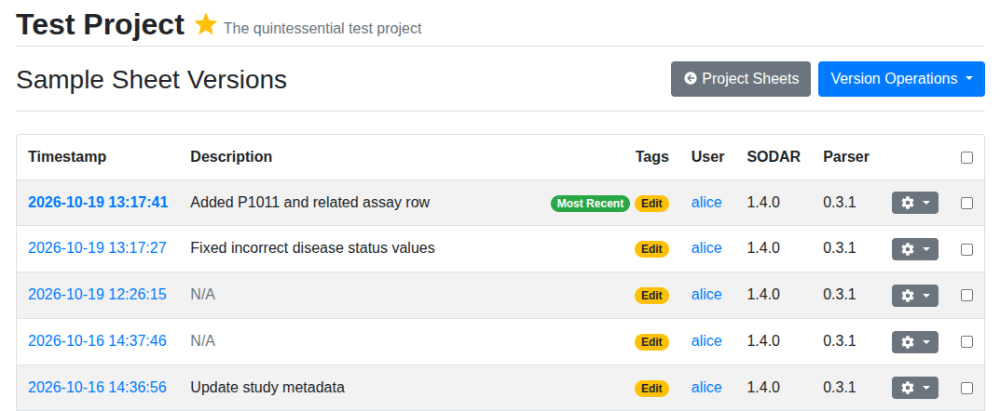
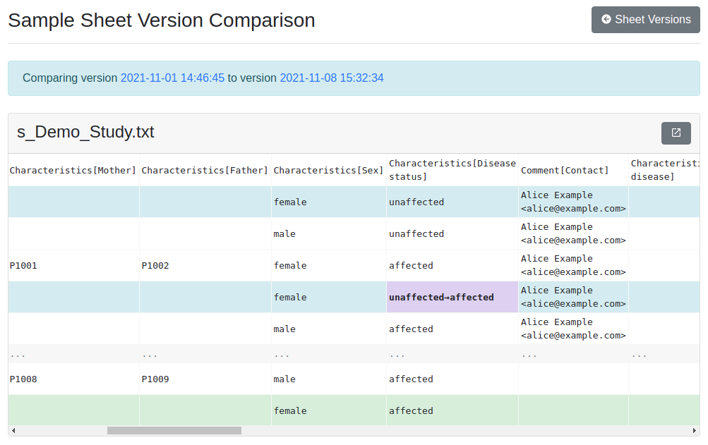

.. _app_samplesheets_version:

Sheet Version Management
^^^^^^^^^^^^^^^^^^^^^^^^

Saving backup versions of sample sheets was previously described in
:ref:`app_samplesheets_edit`. This section details the browsing and management
of the saved versions.

Version List
============

To access currently saved sheet versions, open the :guilabel:`Sheet Operations`
dropdown and select :guilabel:`Sheet Versions`. You are directed to the version
list view which lists all the versions saved of the investigation currently in
the project, with the most recent version on top.

    Sample sheet versions list

List Columns
------------

In the list you can see the following columns:

Timestamp
    The title of the version, presented in in form of a timestamp. It acts as a
    link for exporting the version as ISA-Tab.
Description
    A textual description provided by the user upon saving, or added later via
    the list dropdown.
Tags
    Tags assigned to each version, depicting different properties of the
    version.
User
    The user who saved this version of the sample sheets.
SODAR Version
    The SODAR version at the time of the saving of the version. This affects the
    :ref:`export-only SODAR metadata <metadata_advanced_sodar_export>` saved as
    comments into the ISA-Tab investigation.
Parser Version
    The version of the `altamISA <https://github.com/bihealth/altamisa>`_ parser
    used when saving this version.

Version Tags
------------

The following types of tags may be set for versions:

Most Recent
    The most recently updated version.
Import
    Version imported into SODAR from existing ISA-Tab files.
Create
    Version created from Template.
Edit
    Version edited within the Sample Sheets app of SODAR.
Restore
    Old version restored to replace active sheets in the project.

Version Operations
------------------

Accessible by project owner and delegates, there is a dropdown for each version
with the following options:

:guilabel:`Update Description`
    Update the version description.
:guilabel:`Restore Version`
    Replace the current active version of sample sheets with this version.
:guilabel:`Delete Version`
    Delete this version. This can not be undone.

Version Comparison and Deletion
===============================

To the right side of the list there are checkboxes for selecting multiple
versions for actions under the :guilabel:`Version Operations` dropdown. Once
exactly two versions are selected. the :guilabel:`Compare Versions` option
becomes selectable. Clicking this takes you to the version comparison page,
which displays the differences in included tables.

    Sample sheet versions list

To open a comparison table in a new "full screen" browser tab with no other
elements, click the icon in the top right corner of the table card.

Selecting any amount of versions in the version list enables the
:guilabel:`Delete Versions` option, which allows you to delete multiple backup
versions at once.
