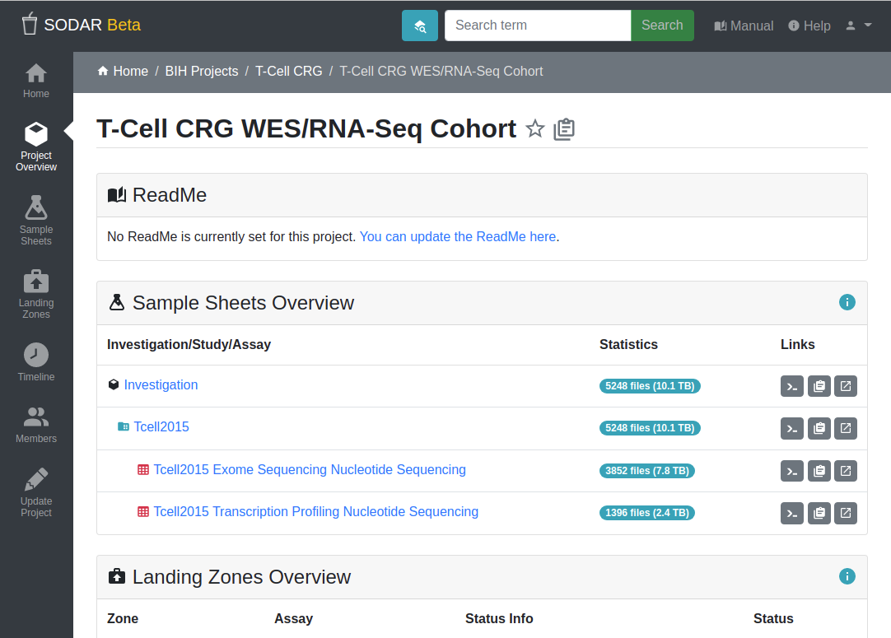
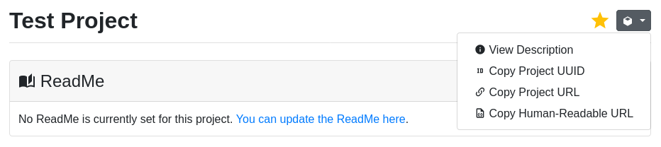
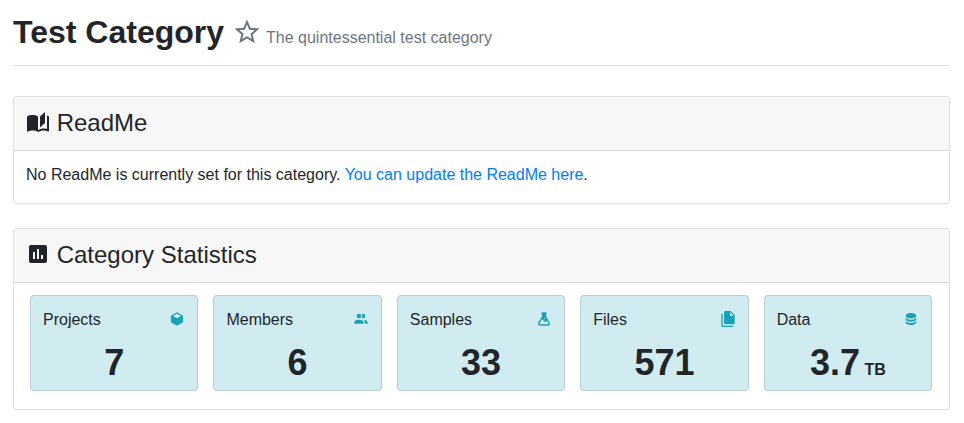

.. _ui_project_overview:

Project Overview
^^^^^^^^^^^^^^^^

Once you navigate into a project, you can see the project overview in the main
content area in your browser. Below the site title bar there is a navigation
breadcrumb. It can be used to easily return to a parent category.

The rest of the view is dedicated to project content. On top of each page is the
project header, which displays the project title and project-specific shortcuts.

    Project overview

The sidebar on the left hand side has been expanded to display links related to
the project. If you are viewing a category instead of a project, you will see a
more limited set of information and sidebar links, while still following the
same general structure.

Project Header
==============

The project header displays the project title along with controls for starring
and a dropdown menu with project-specific shortcuts.

The starring link can be used to toggle the project in your favourites. Once
set, project lists can be filtered to only display your starred projects.

The project dropdown contains the following links to project-specific shortcuts:

View Description
    Open a modal to display a textual description for the project.
Copy Project UUID
    Copy the UUID of the project into the clipboard.
Copy Project URL
    Copy the project overview URL into the clipboard.
Copy Human-Readable URL
    Copy a human-readable redirect URL for the project into the clipboard. This
    can be used to save or share a link to the project in a format easier to
    remember than one containing a UUID. The project title in the URL is
    controlled by the :guilabel:`Title slug` field in the
    :ref:`project update form <ui_project_update>`.

    Project header and the project dropdown

Overview Section
================

The project overview section on the right hand side of the view consists of the
following elements:

Readme
    An optional description for the project in MarkDown notation. Can be updated
    :ref:`project update view <ui_project_update>` by users with an *owner* or
    *delegate* role.
Sample Sheets Overview
    Lists the investigation, studies and assays in the project's
    :ref:`sample sheets <app_samplesheets>`. Along with file statistics you can
    see an iRODS dropdown menu with buttons that allow you to copy the
    corresponding iRODS path to the clipboard, copy the WebDAV URL to the
    clipboard, or directly link into the WebDAV URL for browsing the files.
Landing Zones Overview
    Displays the five most recently created
    :ref:`landing zones <app_landingzones>`.
Timeline Overview
    Displays the five most recent events taken in the project. Your project role
    define the events that you can see.

.. _ui_project_overview_stats:

In the overview of a category, you can also see cumulative statistics for all
projects under that category. These statistics list the amount of projects,
members, samples and files along with the total size of data in iRODS under the
category.

    Category overview with statistics

Sidebar
=======

The sidebar can contain the following links, depending on your access level in
the project:

:ref:`Home <ui_index>`
    Return to the home view.
:ref:`ui_project_overview`
    Return to the project overview page.
:ref:`Sample Sheets <app_samplesheets>`
    Open the Sample Sheets application.
:ref:`Landing Zones <app_landingzones>`
    Open the Landing Zones application.
:ref:`Timeline <ui_project_timeline>`
    Open the Timeline application.
:ref:`Members <ui_project_members>`
    Enter the project members view. This view allows you to see the members with
    access to this project. If you have a project owner or delegate role, you
    can modify project membership roles here.
:ref:`Update Project <ui_project_update>`
    Allows updating project details and settings. Available to project owners
    and delegates.
:ref:`Create Project or Category <ui_project_update>` (for Categories)
    If you are viewing the overview for a category and have owner, delegate or
    contributor access, you will also see a link for creating a new category or
    project under the current category.
