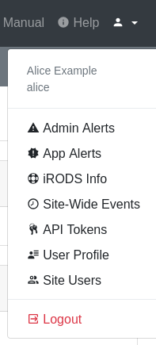

.. _ui_user_dropdown:

User Dropdown
^^^^^^^^^^^^^

The user dropdown menu can be found in the top right corner of the SODAR UI.
It providess access to site-wide applications, which contain functionality and
information not related to a specific SODAR project.

    SODAR user dropdown

In the top of the dropdown your user name and real name are displayed. Below,
you can find links to applications followed by a log out link. Currently, the
following applications are accessible for a logged-in user:

Admin Alerts
    :ref:`Administrator alerts <ui_alerts_admin>` for e.g. site status updates
    can be browsed here.
App Alerts
    Browse :ref:`application alerts <ui_alerts_app>` raised to you regarding
    finished background operations or actions of other users.
iRODS Info
    Display the status of the iRODS file storage and generate user configuration
    files for connecting.
Site-Wide Events
    Display a list of site-wide (non-project specific) timeline events.
API Tokens
    Manage your :ref:`API tokens <ui_api_tokens>` for programmatic SODAR access.
User Profile
    View and configure your global user settings in the
    :ref:`user profile <ui_user_profile>` view.
Site Users
    If enabled, this link will take you to a list of users registered on the
    site. You will also be able to see common projects between you and each
    user.
Logout
    Log out from the site.
