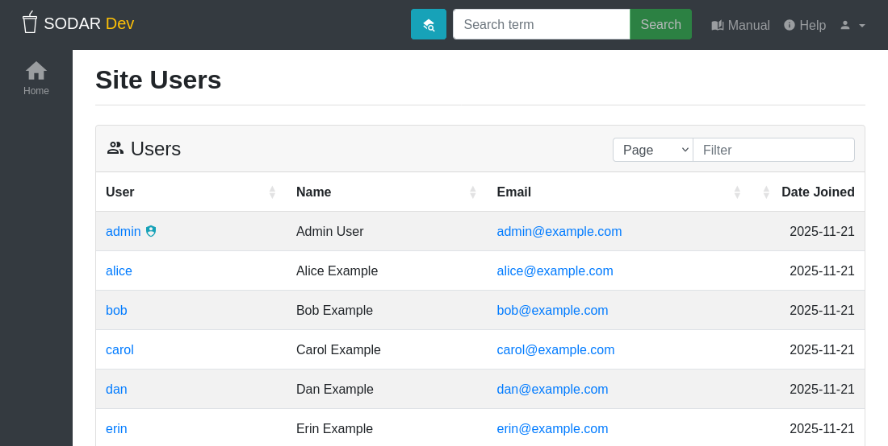

.. _ui_user_list:

Site Users
^^^^^^^^^^

The site user list displays a list of users registered on this SODAR instance.
The list can be sorted by different column and filtered down to a search term.

By clicking on the user name link, you can view their public
:ref:`user profile <ui_user_profile>` containing basic information and a list of
mutual projects both of you can access.

Server administrators can choose whether to enable this view on the site, so it
may be unavailable in your SODAR instance.

    Site users view
